<p align="center">
  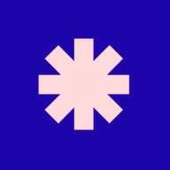
</p>

<h1 align="center">🚌 Bus Buddy</h1>

<p align="center">
  <b>Prendre le bus en toute autonomie, même quand on ne parle pas, on n'entend pas ou on a besoin d'aide.</b><br>
  Une application web simple, colorée et rassurante, pensée avec et pour les personnes en situation de handicap. 💜
</p>

<p align="center">
  <a href="https://massyle78.github.io/LeFoyer/"><b>👉 Essayer l'application</b></a> ·
  <a href="https://massyle78.github.io/LeFoyer/?demo=2"><b>🎬 Voir la démo automatique</b></a> ·
  <a href="https://massyle78.github.io/LeFoyer/qr/"><b>🔳 Les QR codes des bus</b></a>
</p>

<p align="center">
  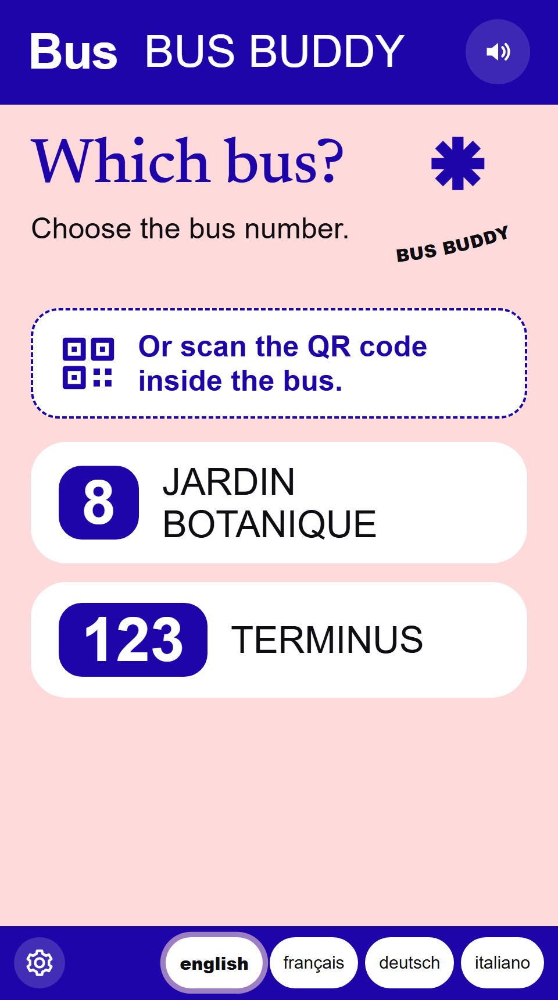
  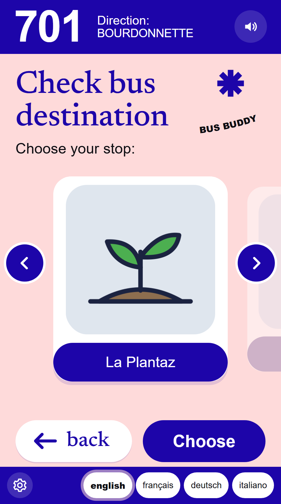
  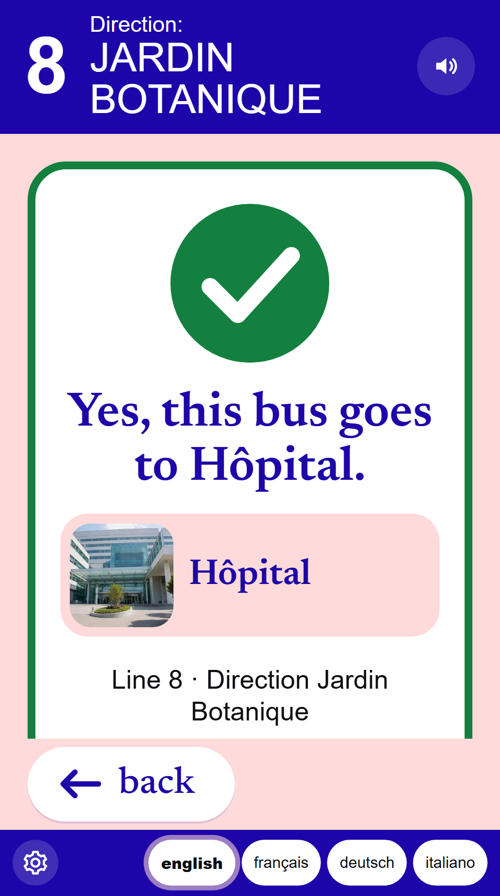
  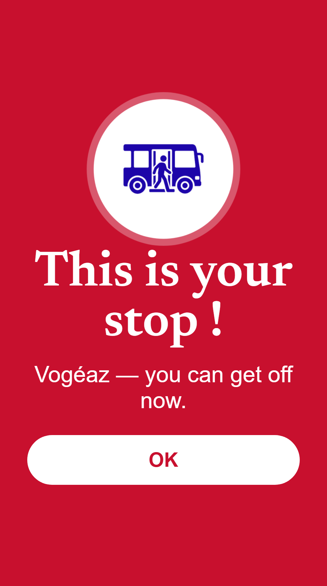
</p>

---

## 🎯 Le projet

Bus Buddy est né du projet **Le Foyer / HackaHealth**. L'idée : un **compagnon de trajet dans la poche**, qui aide à
prendre le bus **sans avoir à parler ni à écrire**, et sans jamais déranger le conducteur.

| 💡 Principe | Ce que ça change |
|---|---|
| 🔳 **Un QR code par bus** | On scanne le QR collé dans le bus : la bonne ligne s'ouvre toute seule. Sinon, on choisit sa ligne dans la liste. |
| 👆 **Tout parle au toucher** | Chaque bouton est dit à voix haute dès qu'on le touche, puis ouvre la catégorie. |
| 🎨 **Des couleurs qui disent l'essentiel** | 🟢 tout va bien · 🟠 je me prépare ou j'ai besoin d'aide · 🔴 j'agis maintenant. Jamais la couleur seule : toujours une icône et un texte. |
| 📳 **Des vibrations pour les moments importants** | Le téléphone vibre quand mon arrêt approche, et fort quand il faut descendre. |
| 🙋 **Très peu de choix** | Dire bonjour, vérifier le bus, acheter un billet, demander de l'aide. Rien de plus. |
| 🗣️ **Se faire comprendre sans parler** | De grandes cartes, dites à voix haute **pour les personnes autour** : « J'ai besoin d'une rampe », « Répétez doucement, s'il vous plaît » (un seul toucher sur la bulle), « Une place assise » (dans l'aide). |
| 🔒 **Tout reste sur le téléphone** | Aucune communication avec le conducteur, aucun compte, rien n'est envoyé au serveur. |
| 🌍 **4 langues** | 🇬🇧 English · 🇫🇷 Français · 🇩🇪 Deutsch · 🇮🇹 Italiano, changeables à tout moment. |

Charte graphique : violet `#1D05A9`, violet clair `#9C7EC3`, rose `#FEDADA`.

---

## 🌐 Adresses déployées

L'application est hébergée sur **GitHub Pages** et se met à jour à chaque `git push` sur `main`.

| | Adresse |
|---|---|
| 🏠 **Accueil** (choix du bus) | https://massyle78.github.io/LeFoyer/ |
| 🚌 **Ligne 701 → Bourdonnette** ⭐ ligne par défaut (comme le QR du bus) | https://massyle78.github.io/LeFoyer/?line=701 |
| 🚌 **Ligne 701 → La Plantaz** (sens inverse) | https://massyle78.github.io/LeFoyer/?line=701-tolochenaz |
| 🧪 Lignes de test fictives | https://massyle78.github.io/LeFoyer/?line=8 · https://massyle78.github.io/LeFoyer/?line=123 |
| 🔳 **QR codes à imprimer** | https://massyle78.github.io/LeFoyer/qr/ |
| 🎬 **Démo automatique** | https://massyle78.github.io/LeFoyer/?demo=2 |
| ⚡ **Démo rapide** (×4) | https://massyle78.github.io/LeFoyer/?demo=4 |
| 🇫🇷 **Démo en français, en boucle** (stand, salon…) | https://massyle78.github.io/LeFoyer/?demo=2&lang=fr&loop=1 |
| 🖥️ **Page de présentation** (diapositive : équipe · démo · QR code) | https://massyle78.github.io/LeFoyer/present/ |
| 💻 **Code source** | https://github.com/Massyle78/LeFoyer |

📱 **Sur téléphone** : scanne ce QR code pour ouvrir l'application.

<p align="center">
  
</p>

---

## 🚌 La ligne par défaut : le 701 Morges ⇄ Lausanne

Une **vraie ligne** de la région lausannoise (MBC) : **Tolochenaz, La Plantaz → Morges → Préverenges → Denges → St-Sulpice VD → Ecublens VD → Lausanne, Bourdonnette**,
soit **24 arrêts par sens**. Chaque arrêt a son **pictogramme** (une idée par image, dessin bleu nuit sur une tuile dont la couleur est celle de la commune),
pensé pour être reconnu d'un coup d'œil sans savoir lire : 🪴 La Plantaz · 🦁 Prélionne · 🚆 Gare de Morges · 🎰 Casino · ⛪ Temple · 🧱 Pierraz-Mur ·
🔬 Parc Scientifique · 📡 Campus des Médias · 🍾 Champagne · 🌾 Blévallaire · 🌳 Allée de Dorigny · 🏢 Bourdonnette…

À Morges, le bus fait une boucle à sens unique : vers Bourdonnette il dessert *Casino* et *Temple*, vers Tolochenaz *St-Louis* et *Charpentiers*.
Il y a donc **deux entrées de ligne** (un QR code par sens) : `701` (→ Bourdonnette, par défaut) et `701-tolochenaz` (→ La Plantaz).

<p align="center">
  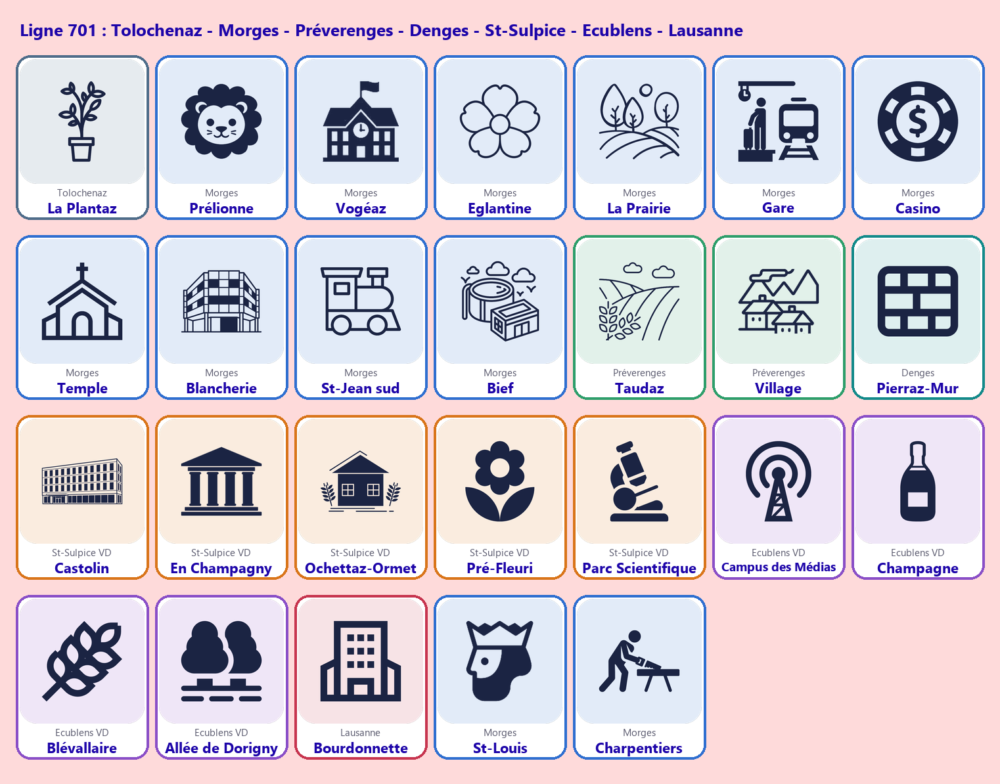
</p>

> ℹ️ Les pictogrammes des 26 arrêts viennent du dossier `701_stops` de la nouvelle charte graphique (`tools/import_stop_pictos.py`) :
> un arrêt absent du dossier garde son pictogramme précédent. Les icônes principales de l'application (bonjour, bus, billet, aide, descendre,
> perdu(e), malaise, répétez doucement) viennent de `main icons` (`tools/import_icons.py`).
> Les lignes **8** et **123** restent disponibles comme lignes de test fictives.

---

## 👥 L'équipe au travail

Bus Buddy se construit avec les personnes concernées : on dessine, on imprime des cartes, on teste, on recommence. 🛠️

<table>
  <tr>
    <td align="center">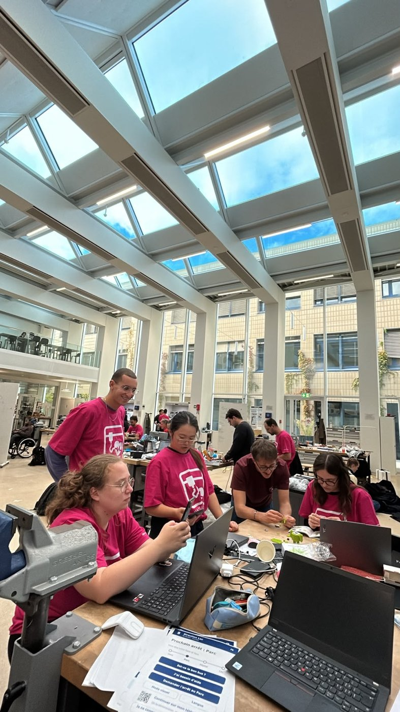<br><sub>🧩 Maquettes papier et premiers essais sur la table</sub></td>
    <td align="center">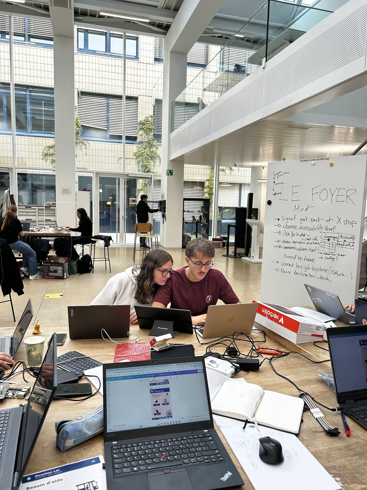<br><sub>📝 Le tableau « LE FOYER » : signaler la descente, accessibilité, billet, QR code…</sub></td>
  </tr>
  <tr>
    <td align="center">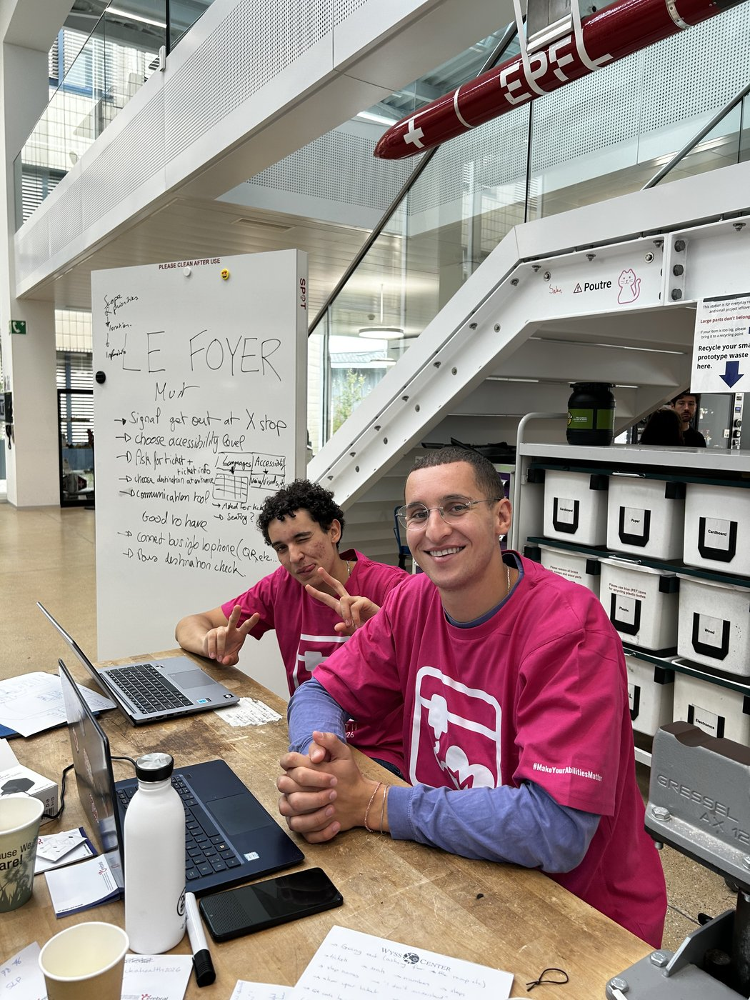<br><sub>✌️ Bonne humeur devant le tableau du projet</sub></td>
    <td align="center">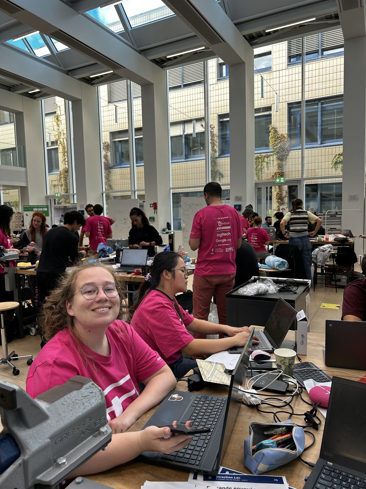<br><sub>💻 Tout le monde au travail pendant le hackathon</sub></td>
  </tr>
  <tr>
    <td align="center" colspan="2">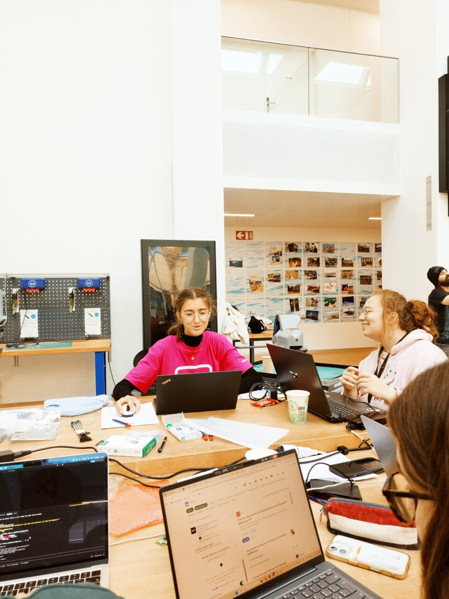<br><sub>🤝 On avance ensemble, ordinateurs, câbles et bonne humeur</sub></td>
  </tr>
</table>

---

## 📸 Un tour en images

<table>
  <tr>
    <td align="center"><br><b>1. Choisir son bus</b><br><sub>scanner le QR ou choisir la ligne</sub></td>
    <td align="center">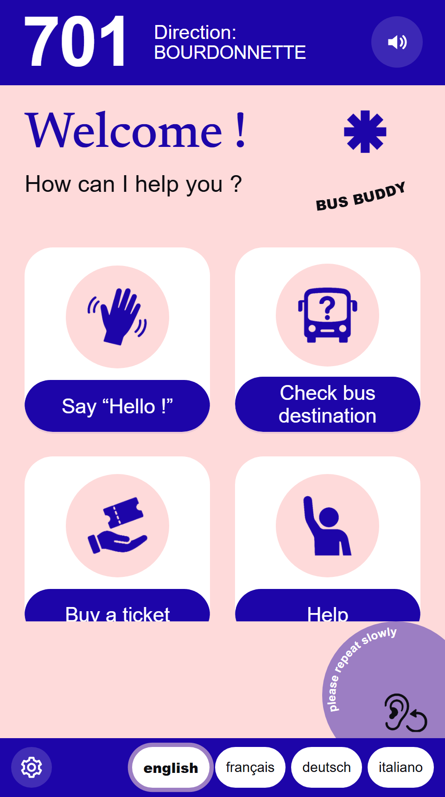<br><b>2. Accueil</b><br><sub>4 grandes tuiles, toutes parlantes</sub></td>
    <td align="center"><br><b>3. Choisir un arrêt</b><br><sub>carrousel horizontal, un arrêt à la fois</sub></td>
  </tr>
  <tr>
    <td align="center"><br><b>🟢 Oui, ce bus y va</b><br><sub>vert = tout va bien</sub></td>
    <td align="center">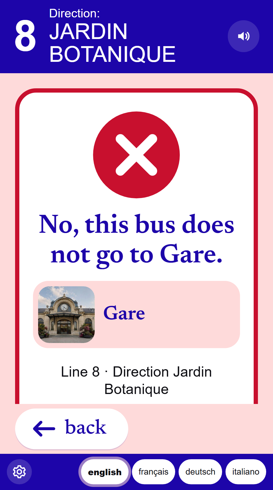<br><b>🔴 Non, ce n'est pas le bon bus</b><br><sub>rouge = j'agis</sub></td>
    <td align="center">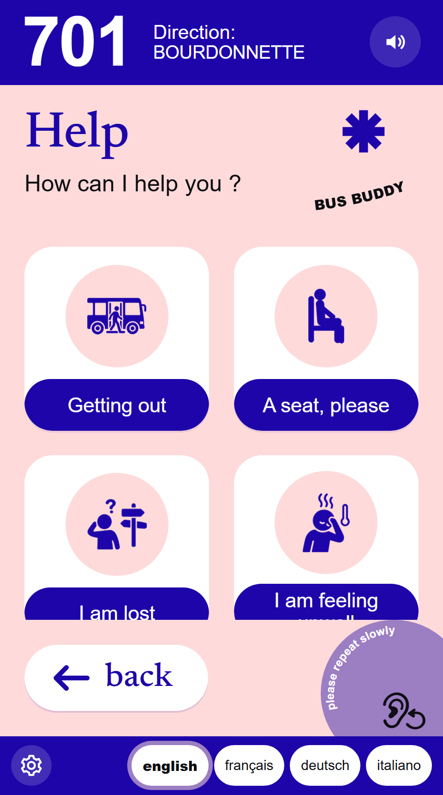<br><b>🙋 Aide</b><br><sub>descendre, place assise, perdu(e), malaise</sub></td>
  </tr>
  <tr>
    <td align="center">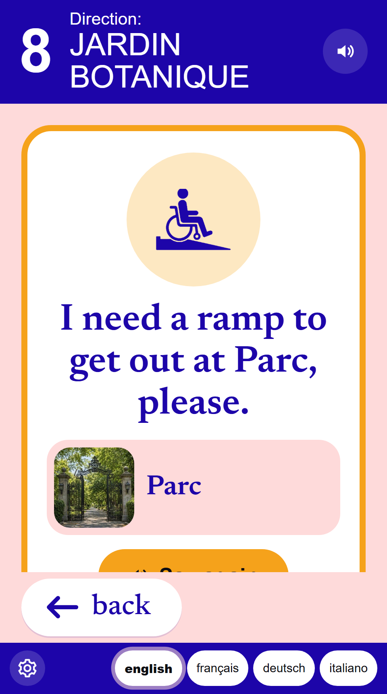<br><b>🟠 « J'ai besoin d'une rampe »</b><br><sub>carte à montrer, dite à voix haute</sub></td>
    <td align="center">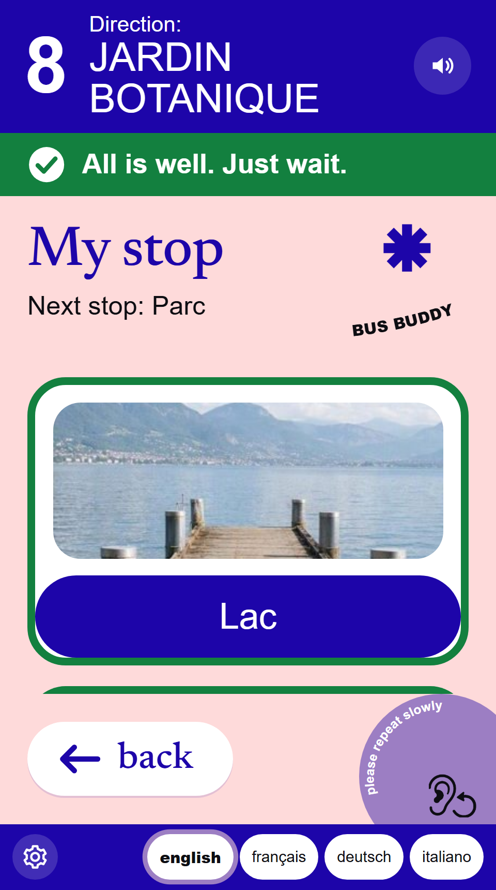<br><b>📍 Mon arrêt</b><br><sub>pictogramme, arrêts restants, bande verte</sub></td>
    <td align="center">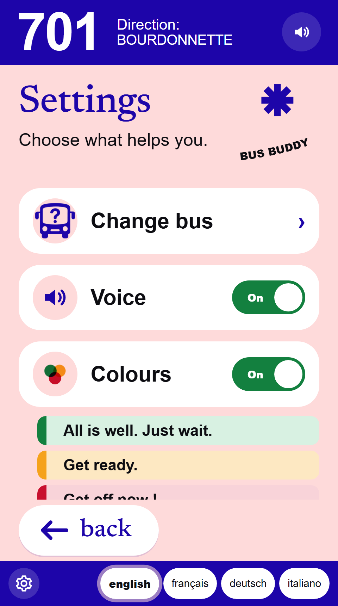<br><b>⚙️ Réglages</b><br><sub>voix, couleurs, vibration, changer de bus</sub></td>
  </tr>
  <tr>
    <td align="center">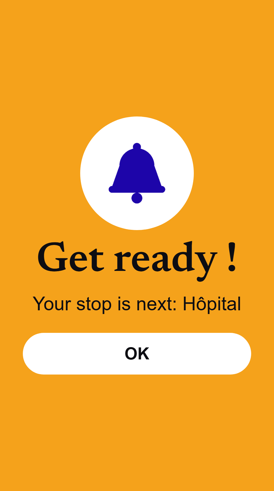<br><b>🟠 Préparez-vous</b><br><sub>mon arrêt est le prochain (2 vibrations)</sub></td>
    <td align="center"><br><b>🔴 C'est votre arrêt !</b><br><sub>plein écran, voix, forte vibration</sub></td>
    <td align="center">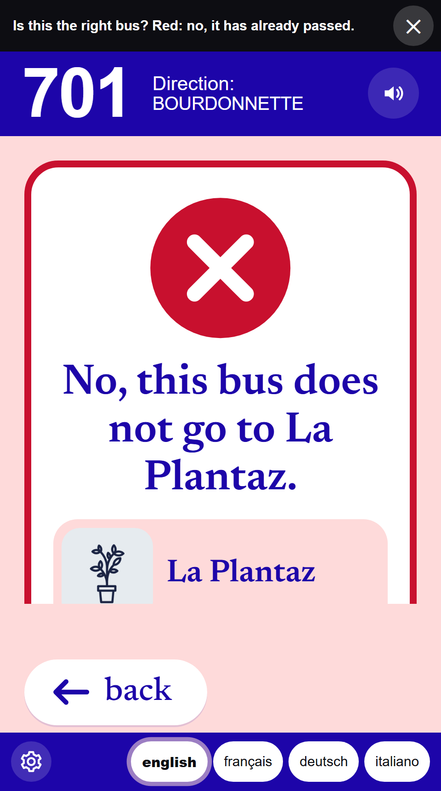<br><b>🎬 Démo automatique</b><br><sub>le bandeau noir explique chaque étape</sub></td>
  </tr>
</table>

---

## ✨ Le parcours d'un voyageur

1. 🔳 **Choisir son bus** : scan du QR du bus (appareil photo du téléphone : le QR ouvre `/?line=701`), ou bouton **Scanner le QR code**
   intégré quand le navigateur sait lire les QR codes (en HTTPS ou sur `localhost`), ou choix de la ligne dans la liste.
   Le numéro de ligne en haut (ou **Réglages › Changer de bus**) ramène à ce choix.
2. 👋 **Accueil** : *Dire bonjour*, *Vérifier la destination du bus*, *Acheter un billet*, *Aide*.
3. 👆 Un toucher sur une tuile **la dit à voix haute** puis ouvre la catégorie. Les arrêts se choisissent dans un carrousel
   horizontal (un arrêt à la fois, voisins en transparence ; le nom est dit quand il arrive au centre).
4. 🙋 **Aide** : *Descendre* (rampe, porte avant, plus de temps, **me rappeler mon arrêt**), *Une place assise*,
   *Je suis perdu(e)*, *Je ne me sens pas bien*. Ces demandes s'affichent en grand et se disent **pour les personnes autour**.
5. 💬 **Bulle « Répétez doucement »** (en bas à droite) : un seul toucher, la phrase est dite et s'affiche directement en grand.
6. 📍 **Mon arrêt** : pictogramme (ou photo), nombre d'arrêts restants, frise avec « ··· » (au plus 4 repères affichés) ; alarme plein écran
   (« Préparez-vous » puis « C'est votre arrêt ») avec voix, vibration et écran maintenu allumé.
7. ⬅️ **Retour** partout (le bouton retour du téléphone fonctionne aussi). En bas : **⚙️ Réglages** puis les langues.

---

## 🎬 Démo automatique : `?demo=x`

`x` est la **vitesse** : `?demo=1` normale (environ 3 min), `?demo=2` deux fois plus vite, `?demo=4` en moins d'une minute, environ 40 s (de 0,5 à 8).
Un écran de départ demande un toucher (nécessaire pour que le navigateur autorise la voix et la vibration), puis l'application
« touche » elle-même les vrais boutons, avec une mise en évidence jaune et un bandeau noir qui explique ce qui est montré :

🔳 choix de la ligne → 👆 tout parle au toucher → 🟢🔴 bon / mauvais bus → 🟠 aide pour descendre → 🔴 urgence →
💬 « répétez doucement » (un seul toucher sur la bulle) + 🪑 place assise (dans l'aide) → 📍 rappel de mon arrêt avec alarmes 🟠 puis 🔴 et vibrations →
⚙️ réglages → 🌍 changement de langue.

La démo se joue sur la **ligne par défaut (701)**, avec ses pictogrammes d'arrêts et les nouvelles icônes. La croix du bandeau l'arrête à tout moment.

- `&autostart=1` : démarre sans l'écran de départ (voix et vibration peuvent alors être bloquées par le navigateur) ;
- `&loop=1` : rejoue la démo en boucle ;
- `&tour=pitch` : la **démo courte d'une minute** (voir ci-dessous) au lieu du tour complet ;
- `&intro=it` : (avec `&tour=pitch`) la démo commence dans cette langue (bonjour en italien) puis passe à la langue de `?lang=` : `/?demo=1&tour=pitch&lang=fr&intro=it` ;
- exemple : `/?demo=2&lang=fr&loop=1`.

### ⏱️ La démo d'une minute : `&tour=pitch`

Pensée pour une présentation, dans l'ordre d'un vrai trajet :
👋 **bonjour** (un toucher, le téléphone parle) → 🚌 **vérifier le bus** (🔴 pas le bon bus, puis 🟢 le bon) → 🎫 **acheter un billet** (la phrase s'affiche en grand) →
🙋 **besoin d'aide** (🔴 urgence, puis « répétez doucement » en un toucher) → 🔔 **notifications** (je choisis mon arrêt : 🟠 « préparez-vous » puis 🔴 « descendez » avec vibrations).
Exemple : https://massyle78.github.io/LeFoyer/?demo=1&tour=pitch&lang=fr

### 🎞️ Vidéo de la démo (1 minute)

<p align="center">
  <a href="docs/video/bus-buddy-demo.mp4">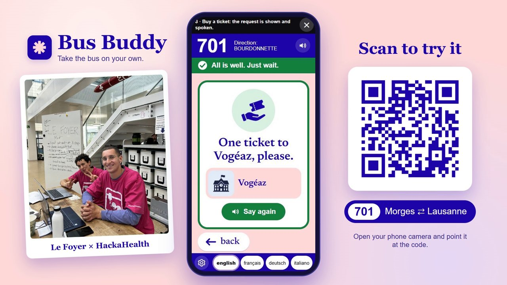</a><br>
  <sub>▶️ <a href="docs/video/bus-buddy-demo.mp4"><b>Version diapositive 16:9</b></a> (équipe · démo · QR code, 1920×1080) ·
  <a href="docs/video/bus-buddy-demo-phone.mp4"><b>Téléphone seul</b></a> (780×1600) · vidéos muettes : le bandeau explique chaque étape</sub>
</p>

<p align="center">
  <a href="docs/video/bus-buddy-demo-fr.mp4">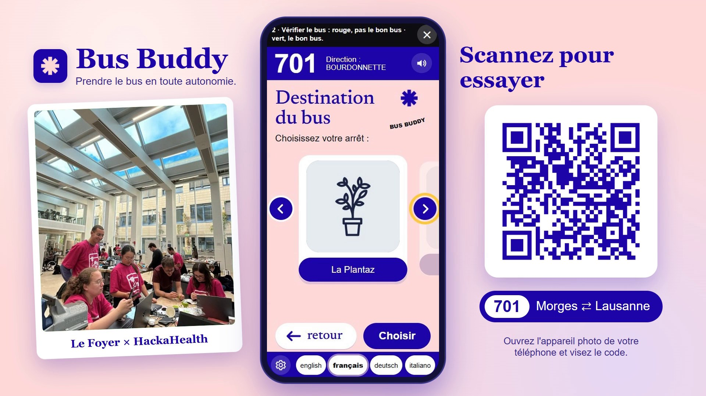</a><br>
  <sub>🇫🇷 <a href="docs/video/bus-buddy-demo-fr.mp4"><b>Version française, diapositive 16:9</b></a> ·
  <a href="docs/video/bus-buddy-demo-fr-phone.mp4"><b>téléphone seul</b></a> · elle commence par un **bonjour en italien** (🇮🇹 « Ciao ! ») pour montrer que l'application parle plusieurs langues, puis passe au français</sub>
</p>

Les vidéos sont générées automatiquement par `tools/record_demo.py` (Chrome sans interface + PyAV) :

```
python app.py                                          # dans un autre terminal
python tools/record_demo.py http://localhost:5000      # docs/video/bus-buddy-demo.mp4 (diapo)
python tools/record_demo.py http://localhost:5000 --phone              # téléphone seul
python tools/record_demo.py http://localhost:5000 --lang fr --intro it   # version française : bonjour en italien, puis français (docs/video/bus-buddy-demo-fr.mp4)
```

---

## 🖥️ Page de présentation (pour une diapositive)

Une page pensée pour **être enregistrée en plein écran (16:9)** puis posée au milieu d'une diapositive : à gauche 📸 les photos de l'équipe
(diaporama de 5 photos), au centre 📱 un téléphone qui joue la **démo d'une minute, automatique et interactive** (on peut aussi toucher l'écran), à droite 🔳 le
**QR code de la ligne 701** pour que le public l'essaie.

👉 https://massyle78.github.io/LeFoyer/present/ (en local : `http://localhost:5000/present`)

| Paramètre / touche | Effet |
|---|---|
| `?demo=1` | vitesse de la démo (1 normale, 2 deux fois plus vite…) |
| `&lang=en\|fr\|de\|it` | langue de la démo et des textes (touche **L** pour en changer) |
| `&tour=full` | le tour complet (environ 3 min) au lieu de la démo courte d'une minute (par défaut) |
| `&intro=it` | la démo dit d'abord bonjour dans cette langue, puis passe à `&lang=` (ex. `?lang=fr&intro=it`) |
| `&loop=0` | ne pas rejouer en boucle (par défaut la démo tourne en boucle) |
| `&autostart=1` | lance la démo sans l'écran de départ (sinon : un toucher dans le téléphone autorise la voix) |
| `&rec=1` | masque les commandes (qui n'apparaissent de toute façon qu'au survol de la souris) |
| **F** · **R** | plein écran · relancer la démo |

Astuce d'enregistrement : soit utiliser les **vidéos toutes faites** (`docs/video/`), soit ouvrir la page en plein écran (F), toucher une fois l'écran de départ du téléphone pour avoir la voix, puis enregistrer
l'écran. Le QR code encode l'adresse du site déployé ; en local il encode l'adresse de l'ordinateur sur le réseau (voir `BUSBUDDY_PUBLIC_URL`).

---

## 🎁 Pin's et souvenirs (découpe laser)

`merch/bus-buddy-pins.dxf` : une planche **300 × 200 mm** de **30 pièces**, prête pour la découpe laser (acrylique ou contreplaqué de 3 mm) :
6 modèles de pin's (🔵 rond · 🚌 bus · 🏠 « Le Foyer » · 💜 cœur · 🛑 panneau d'arrêt 701 · 💬 « Hello ! »), les 6 mêmes en **porte-clés** (anneau avec trou Ø 3,6 mm),
et **18 petits souvenirs** centrés sur l'identité du projet (Le Foyer, HackaHealth, Bus Buddy, EPFL, l'équipe ; texte « TEAM » générique, sans noms propres) :

- **10 mini badges Ø 25 mm** (rangée 3) : `M01` astérisque + BUS BUDDY · `M02` texte courbe « BUS BUDDY / LE FOYER » autour de l'astérisque · `M03` maison + « TEAM / LE FOYER » en arc ·
  `M04` cœur + HACKA/HEALTH 2026 · `M05` texte courbe « HACKAHEALTH / EPFL 2026 » autour d'une croix santé · `M06` EPFL 2026 · `M07` bus + TEAM 701 ·
  `M08` texte courbe « HACKAHEALTH / BUS BUDDY » autour d'un bus · `M09` HACKA/HEALTH 2026 · `M10` TEAM + LE FOYER.
- **8 petites formes** (rangée 4) : 2 **étiquettes** à trou Ø 3,6 mm pour porte-clés/sac (`T1` LE FOYER + HACKAHEALTH, `T2` BUS BUDDY + EPFL 2026), 2 **écussons** (`S1` EPFL, `S2` HACKA/HEALTH),
  2 **cœurs** (`H1` TEAM, `H2` BUS BUDDY) et 2 **hexagones** (`X1` HACKA/HEALTH + croix santé, `X2` maison + LE FOYER).

Les badges et formes sans trou se collent sur un pin's à dos de 20 mm (rien à découper au dos). Gravure lisible : capitales de 2,2 mm minimum, liseré à 1,4 mm du bord, au moins 0,4 mm entre le texte et le liseré.
Le nom s'écrit « HackaHealth » (hackahealth.ch), gravé en capitales ; le logo EPFL n'est pas reproduit (texte seul) et seuls l'astérisque Bus Buddy, la maison, le cœur, la croix et le bus sont des dessins faits maison.
Calques : `CUT` (rouge, à découper), `ENGRAVE` (bleu, à graver), `SHEET` et `LABELS` (repères, à ne pas découper). Aperçu : `merch/bus-buddy-pins.png`.

```
python tools/make_pins_dxf.py                  # régénère le DXF et l'aperçu
python tools/make_pins_dxf.py --sheet 400x300  # autre taille de plaque
```

---

## 🎨 Couleurs et vibrations

Trois moments, toujours doublés d'une icône et d'un texte (la couleur n'est jamais la seule information) :

| Couleur | Sens | Exemples |
|---|---|---|
| 🟢 **Vert** | tout va bien, j'attends | bande « Tout va bien. Patientez. » · « oui, ce bus va à… » · phrases polies (bonjour, billet, place assise…) |
| 🟠 **Orange** | je me prépare / j'ai besoin d'aide | « Préparez-vous » (mon arrêt est le prochain) · rampe, porte avant, plus de temps, je suis perdu(e) |
| 🔴 **Rouge** | j'agis maintenant | « Descendez maintenant ! » (alarme rouge qui pulse) · « non, ce n'est pas le bon bus » · je ne me sens pas bien |

La bande de couleur apparaît sous le bandeau dès qu'un arrêt est choisi ; la bordure du bloc « Mon arrêt » suit la même couleur.

**⚙️ Écran Réglages** : trois interrupteurs mémorisés sur le téléphone — **Voix** 🔊, **Couleurs** 🎨 (coupées : tout redevient violet) et
**Vibration** 📳 (remise en marche : petit essai). Le haut-parleur du bandeau coupe/rétablit la voix rapidement.

| 📳 Vibration | Moment |
|---|---|
| 1 très courte | je touche un bouton |
| 2 courtes | choix enregistré (mon arrêt, une demande) · « oui, bon bus » |
| 1 longue | « non, ce n'est pas le bon bus » |
| 1 moyenne | le bus vient de s'arrêter à un arrêt (quand j'ai choisi mon arrêt) |
| 2 moyennes | 🟠 **orange** : mon arrêt est le prochain |
| 3 longues + 1 très longue | 🔴 **rouge : c'est mon arrêt** — recommence toutes les 6 s jusqu'à ce qu'on touche « OK » |

Les motifs sont dans `static/js/a11y.js` (`vibrationService.patterns`). La vibration web fonctionne sur Android (Chrome, Firefox) ;
**pas sur iPhone** (Safari ne l'autorise pas) : l'écran Réglages l'indique.

---

## 💻 Lancer en local

```
pip install -r requirements.txt
python app.py                 # http://localhost:5000
```

- `http://localhost:5000/` : la **page d'accueil est le choix du bus**.
- `http://localhost:5000/?demo=2` : **démo automatique** (voir plus haut).
- `http://localhost:5000/?manual=1` : démo à la main (bandeau « arrêt suivant » sous l'en-tête, ou touche **N**, pour faire avancer le bus).
- `http://localhost:5000/qr` : un **QR code par ligne** (à imprimer et coller dans les bus). Le QR ouvre `/?line=701` (un QR par sens).
  Pour qu'un téléphone puisse les scanner, il doit être sur le même Wi-Fi ; l'adresse de l'ordinateur sur le réseau est détectée
  automatiquement. En production : `BUSBUDDY_PUBLIC_URL=https://mon-site.org python app.py`.
- Paramètres d'adresse : `?line=701` (ouvre directement ce bus, c'est le QR code ; clé d'une ligne = un sens, ex. `701-tolochenaz`) · `?lang=fr|en|de|it` · `?demo=x` · `&autostart=1` · `&loop=1` ·
  `?manual=1` · `?speed=20` (le bus avance tout seul toutes les 20 s).
- `/preview?q=lang%3Dfr%26line%3D8&q=...&scale=0.66` : plusieurs écrans côte à côte en taille téléphone (outil de développement ;
  `?view=help`, `?view=picker&p={"need":"ramp"}`, `&dest=lac` ouvrent directement un écran).

### 🚀 Déploiement

Chaque `git push` sur `main` lance le workflow `.github/workflows/pages.yml` : tests → construction du site statique
(`python tools/build_site.py <url>`, avec les QR codes préfabriqués dans `/qr/`) → publication sur GitHub Pages.

### 📸 Régénérer les captures d'écran de ce README

```
python tools/screenshots.py                        # depuis le site déployé
python tools/screenshots.py http://localhost:5000  # depuis le serveur local
```

---

## 🧩 Où modifier / étendre

| Pour… | Fichier |
|---|---|
| Ajouter une **langue** | `static/i18n/xx.json` (copier `en.json`) + ajouter le code dans `LANGS` (`static/js/store.js`) et la voix dans `_speech` |
| Changer les **lignes / arrêts** | `static/data/lines.json` (un arrêt a un `picto` ou une `photo` dans `static/img/stops/` ; `"default"` = ligne par défaut, en tête de liste et utilisée par la démo) |
| **Importer une nouvelle ligne avec pictogrammes** | `python tools/import_line.py "<dossier ou .zip du paquet>" [--default]` : copie les pictogrammes, crée une entrée par sens et un QR code par sens |
| Remplacer les **pictogrammes des arrêts** (701) | `python tools/import_stop_pictos.py "<701_stops.zip>"` : noir sur blanc, PNG/JPG/SVG → tuiles 512 px aux couleurs des communes ; puis `python tools/overview_701.py` pour la planche du README |
| Remplacer les **icônes principales** (bonjour, billet, aide…) | `python tools/import_icons.py "<main icons.zip>"` : dessins noirs → PNG transparents dans `static/img/icons/` |
| Ajouter un **service d'accessibilité** (lecture, haptique, braille…) | `static/js/a11y.js` : créer un objet `{ name, speak?, feedback?, stop? }` et l'enregistrer avec `register()` dans `main.js` |
| Brancher la **vraie position** (GPS / API temps réel) | remplacer `SimulatedPosition` (`static/js/position.js`) : il suffit de fournir `state = { next, atStop }` et d'appeler `onChange` |
| Modifier la **démo automatique** | `static/js/demo.js` (les scénarios `fullTour()` et `pitch()`) et les textes `demo.c.*` dans `static/i18n/*.json` |
| Couleurs, tailles | variables en tête de `static/css/app.css` |
| Régénérer **icônes et photos** depuis la charte | `python tools/build_assets.py` (nécessite pillow) |

---

## ✅ Tests

```
node --test tests/                                   # logique pure (frise « ··· », alarme, arrêts restants, paramètre demo)
python -m unittest discover -s tests -p "test_*.py"  # serveur, QR codes, langues complètes
```

`tools/flow_test.js` est un parcours complet (choix de la ligne, carrousel, retour, aide, alarmes, réglages, langue, changement de bus)
à exécuter dans la console du navigateur sur `/?lang=en&manual=1` (après `localStorage.clear()`). La démo automatique (`?demo=x`)
joue un parcours équivalent toute seule.

---

## ⚠️ Limites connues / points ouverts

- Une web app **ne peut pas sonner de façon fiable en arrière-plan** : l'alarme fonctionne tant que l'app est ouverte (écran maintenu allumé grâce à Wake Lock).
- Le mode hors-ligne (service worker) exige HTTPS (ou `localhost`) ; en HTTP sur une adresse locale l'app fonctionne mais sans cache hors-ligne.
- Le scanner de QR code intégré dépend du navigateur (BarcodeDetector : Chrome Android surtout) et demande HTTPS ; sinon, utiliser l'appareil photo du téléphone.
- La position du bus est **simulée** (pas de GPS ni de flux temps réel).
- Traductions allemand / italien non relues ; pictogrammes d'arrêts et icônes fournis par l'équipe (à valider sur le terrain, notamment les arrêts proches ou ambigus).
- La synthèse vocale dépend des voix installées sur le téléphone.

---

<p align="center">
  Fait avec 💜 pour <b>Le Foyer</b> et <b>HackaHealth</b>
</p>
